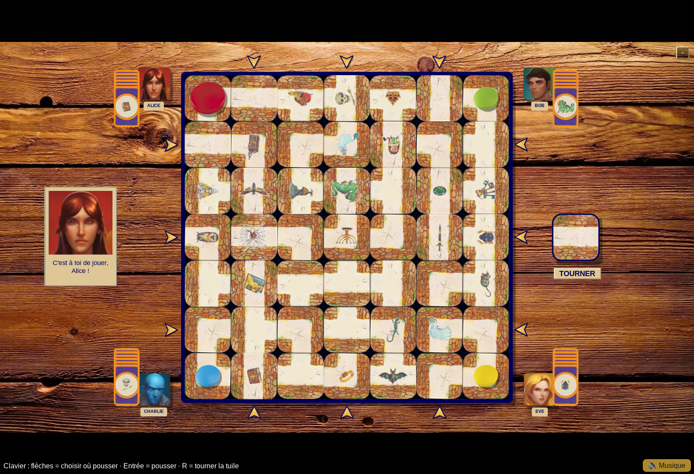

Labyrinthe
==========

Une version du jeu de société *Labyrinthe* à 4 joueurs sur le même écran, en Java (Swing).

Jouer
-----

- **En ligne** : [https://elenafri.github.io/labyrinthe/](https://elenafri.github.io/labyrinthe/), puis **▶ Jouer**.
- **En local** : voir [`INSTALL.md`](INSTALL.md).

But du jeu
----------

Trouver, dans l'ordre, tous ses trésors (la carte objectif est affichée à gauche), puis revenir à sa case de départ. Le premier qui y parvient gagne.

À son tour
----------

1. *(Facultatif)* Cliquer sur **TOURNER** pour pivoter la tuile supplémentaire.
2. Cliquer sur une **flèche** autour du plateau pour insérer la tuile et pousser la rangée.
3. Déplacer son pion en cliquant sur les cases accessibles (cadre rouge).
4. Cliquer sur **sa case actuelle** pour passer la main au joueur suivant.
